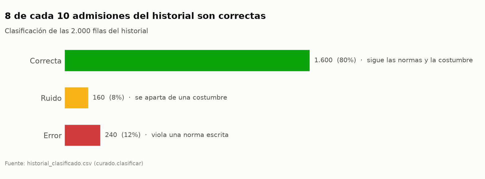
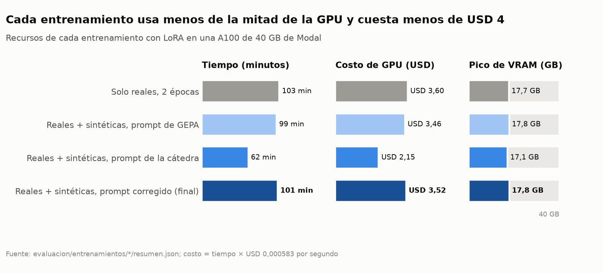
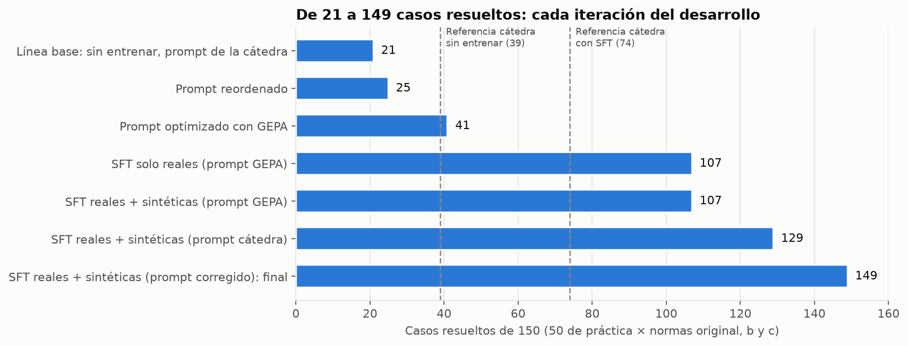
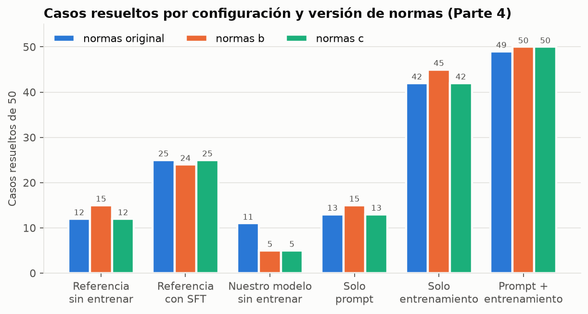
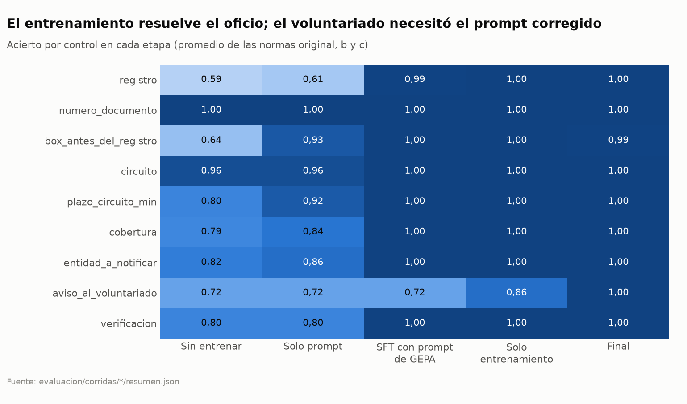
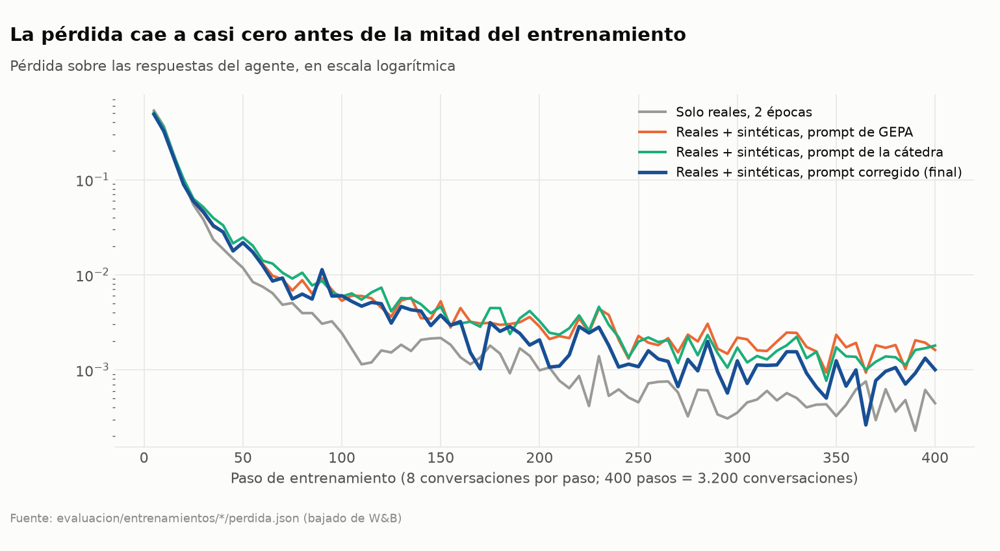
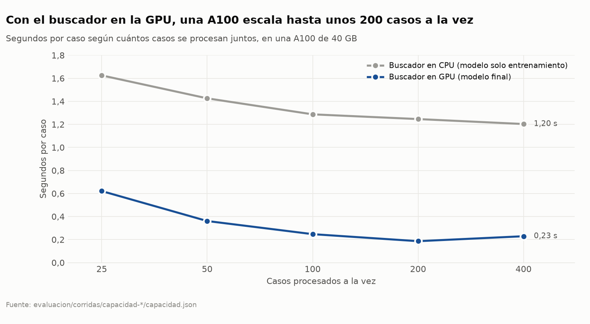

# Informe

Un apartado por parte, con **cada pasada del desarrollo y no solo la final**, incluidos los
experimentos que no funcionaron. Cada número dice qué comando, qué punto de control y qué prompt
lo producen.

## Parte 1 — Curado e ingeniería de datos

### Cómo clasificamos el historial

Las normas escritas que determinan la ficha se codificaron como reglas en `curado/reglas.py`:
NOR-ADM-01 a NOR-ADM-03 para el registro y la ubicación en el box, NOR-TDE-01 a NOR-TDE-04 para
el circuito y su plazo, y NOR-COB-01 a NOR-COB-04 para la cobertura y la entidad a notificar. Los
valores de los parámetros se leen de la carpeta de normas que se recibe, nunca fijos.

Con esas reglas se deriva la ficha que corresponde a cada fila y se compara contra la registrada,
campo por campo. Una diferencia en cualquiera de los siete campos que las normas determinan es un
**error**. El octavo campo, `aviso_al_voluntariado`, no lo cubre ninguna norma, así que se compara
contra la costumbre; apartarse de ella es **ruido**. Lo que no cae en ninguna de las dos es
**correcta**.

Lo produce `curado/clasificar.py`:

```bash
uv run python -m curado.clasificar --kit <ruta al kit>
```

### Filas de cada tipo

| Tipo | Filas | Proporción |
|---|---|---|
| correcta | 1600 | 80,0% |
| error | 240 | 12,0% |
| ruido | 160 | 8,0% |

Los errores, por campo: `plazo_circuito_min` 97, `registro` 64, `box_antes_del_registro` 61,
`cobertura` 12, `entidad_a_notificar` 6. Los campos `numero_documento` y `circuito` no tienen
ningún error en las 2000 filas.

El ruido, por campo: `aviso_al_voluntariado` 151 y `entidad_verificada` 9.



### Un ejemplo de cada tipo

Tres admisiones reales del historial, las tres por **dolor torácico** con las normas originales
(edad para el box: 67 años; plazo del ECG: 10 minutos, 5 menos si llega en ambulancia; dígito
reservado: 7). El motivo de cada clasificación es el que da `curado/clasificar.py`.

> [!TIP]
> **🟢 Correcta: `H-0008`** (operador OP-02)
>
> Paciente de **68 años**, nivel 2, dolor torácico, llegó por sus propios medios, **sin documento**,
> con credencial de **Obra Social Tilcara**, acompañada por su hermana.
>
> | Lo que registró | Por qué está bien |
> |---|---|
> | registro **provisorio** | no presentó documento (NOR-ADM-01) |
> | box antes del registro: **sí** | 68 ≥ 67 años (NOR-ADM-02) |
> | circuito **ECG, 10 min** | dolor torácico y no llegó en ambulancia (NOR-TDE-01) |
> | verificó Obra Social Tilcara → **inactiva** | se verifica la credencial presentada (NOR-COB-02) |
> | cobertura **sin cobertura**, no notifica | afiliación inactiva (NOR-COB-03) |
> | voluntariado: **no** | tiene acompañante (costumbre 1) |
>
> Sigue todas las normas y hace lo que hacen casi todos los operadores. **Entra al entrenamiento.**

> [!WARNING]
> **🟡 Ruido: `H-0005`** (operador OP-04)
>
> Paciente de **35 años**, dolor torácico, sin acompañante, que **se lesionó en el trayecto al
> trabajo**. El operador verificó la ART (Pampa Laboral ART), registró cobertura `art` y el ECG a 10
> minutos: todo lo que fijan las normas está bien.
>
> Pero **avisó al voluntariado**. Ninguna norma habla del voluntariado, así que no viola nada; se
> **aparta de la costumbre**: 17 de los 20 operadores avisan solo con 75 años o más y sin acompañante.
> OP-04 es uno de los tres operadores que avisan fuera de esa situación.
>
> No entra al entrenamiento: enseñaría a ignorar la costumbre.

> [!CAUTION]
> **🔴 Error: `H-0010`** (operador OP-11)
>
> Paciente de 37 años, dolor torácico, **llegó en ambulancia**, con obra social y prepaga.
>
> Registró el ECG a **10 minutos**, pero la NOR-TDE-04 §1 dice que si llega en ambulancia el plazo
> es el del circuito **menos 5 minutos**: correspondían **5**. Viola una norma escrita.
>
> Es el error más común del historial (97 de las 240 filas con error). No entra al entrenamiento:
> enseñaría a violar la norma.

### Cómo encontramos las costumbres

El detalle y la evidencia están en `costumbres.md`. Son dos: el aviso al voluntariado a partir de
los 75 años sin acompañante, y la elección de la prepaga cuando el paciente presenta dos
credenciales.

El hallazgo que las destrabó fue mirar el comportamiento **por operador**. En el agregado, el
aviso al voluntariado parecía casi aleatorio: 17% de las filas, sin ninguna condición que lo
explicara por encima del 60%. Separando por operador aparece el corte: 17 de los 20 avisan
únicamente con 75 años o más y sin acompañante, con cero excepciones en 1674 filas, mientras que
OP-11, OP-17 y OP-04 avisan también fuera de esa situación.

**Las 160 filas de ruido son exactamente las de esos tres operadores**, y ninguna de los otros 17.

Un desvío que al principio parecía costumbre y no lo era: el `plazo_circuito_min` con cinco
minutos de menos. Lo fija NOR-TDE-04 §1 para los pacientes que llegan en ambulancia, así que las
97 filas que no lo respetan son errores.

### Conversaciones de entrenamiento

**En total: 1600 reales y 1600 sintéticas.** Las reales salen de las 1600 filas correctas del
historial; las sintéticas, de un operador experto programado (ver la segunda versión, más abajo). El
modelo final se entrenó con las 3200 juntas.

**Primera versión: 1600 reales, 0 sintéticas.**

Cada traza del historial es una lista de pasos; el modelo se entrena con diálogos. `curado/conversaciones.py`
hace la conversión al formato del agente de ejemplo: mensaje de sistema, pedido inicial, y después un mensaje
del asistente con cada llamada en JSON seguido de uno del usuario con el resultado, salvo tras
`registrar_decision`.

```bash
uv run python -m curado.conversaciones --kit <ruta al kit>
```

Entraron **solo las 1600 filas correctas**. Las 240 con error enseñarían a violar una norma escrita y las 160
con ruido, a apartarse de una costumbre. Quedan disponibles para un experimento posterior: las de ruido no
violan ninguna norma, así que corrigiéndoles el campo que se aparta se podrían sumar 160 ejemplos más y medir
si el modelo mejora. El script acepta `--tipos` para incluirlas.

Dos controles sobre la salida: las 1600 conversaciones quedaron bien formadas —sistema primero, roles
alternados y cierre del asistente con `registrar_decision`— y en las 1600 el último mensaje registra
exactamente la ficha que figura en la traza.

El archivo resultante pesa 18,6 MB y no se versiona: lo regenera el comando de arriba.

### Segunda versión: búsquedas de nuestro buscador y conversaciones sintéticas

Para entrenar (Parte 4) armamos las conversaciones con `entrenamiento/datos.py`, que reemplaza a
`curado/conversaciones.py` en dos cosas:

- **Las 1600 reales con las búsquedas rehechas.** Las trazas guardan lo que devolvía el BM25 de la
  cátedra, que es de 2 secciones enteras. Nuestro agente ve otra cosa: 3 párrafos de bge-m3. Cada
  `buscar_normativa` se vuelve a correr con nuestro buscador sobre las normas originales, que son las
  del historial, y el modelo se entrena con lo que va a ver.
- **1600 sintéticas.** Son casos de `admision.generador` jugados en el entorno de la cátedra por un
  operador experto programado. El operador usa las mismas 14 consultas que los operadores del
  historial y registra la ficha de `curado/etiquetar.py`. Las normas tienen los 9 parámetros que
  deciden la ficha sorteados, con una versión nueva cada 50 casos, así el modelo ve muchos valores
  distintos y tiene que leerlos del buscador. Solo entran los episodios que el comparador del kit da
  por resueltos: **1600 de 1600**, sin descartes.

Generamos cuatro archivos, uno por entrenamiento de la Parte 4; cambian solo el mensaje de sistema y
si llevan sintéticas. Los cuatro están en el repositorio de datasets
`Pedro2204/admision-gemma4-e4b-datos`, con la revisión que registró cada entrenamiento:

| Archivo | Reales | Sintéticas | Prompt | sha256 | Revisión en HF | Entrenamiento |
|---|---|---|---|---|---|---|
| `datos/entrenamiento-reales.jsonl` | 1600 | 0 | optimizado | `b2c2c9dd…` | `9552900a` | `sft-reales` |
| `datos/entrenamiento-mixto.jsonl` | 1600 | 1600 | optimizado | `b38b889b…` | `a8b7cecf` | `sft-mixto` |
| `datos/entrenamiento-mixto-catedra.jsonl` | 1600 | 1600 | de la cátedra | `eb73a57b…` | `86ca6f00` | `sft-mixto-catedra` |
| **`datos/entrenamiento-mixto-final.jsonl`** | **1600** | **1600** | **final** | **`bc6ad9fd…`** | **`d1678aeb`** | **`sft-mixto-final`** |

En las tres generaciones con sintéticas entraron las 1600, sin descartes. Se generan con semilla 0
(los otros dos cambian `--sistema` y la salida; ver README, sección 5):

```bash
uv run python -m entrenamiento.datos --kit <kit> --sistema prompt/sistema_optimizado.txt \
    --semilla 0 --salida datos/entrenamiento-reales.jsonl
uv run python -m entrenamiento.datos --kit <kit> --sistema prompt/sistema_optimizado.txt \
    --sinteticas 1600 --semilla 0 --salida datos/entrenamiento-mixto.jsonl
```

Cada entrenamiento sube el archivo exacto que usó a un repositorio de datasets privado de Hugging
Face, con su revisión (ver Parte 4).

## Parte 2 — Buscador (RAG)

Resultado de `admision.evaluar_rag` sobre `rag/consultas_dev.jsonl`, con `k_entorno = 2`:

| | Recall de evidencia | Precisión | Tokens por consulta | Consultas completas |
|---|---|---|---|---|
| Referencia BM25 | 0,875 | 0,492 | 580 | 51 / 60 |
| BM25 propio, por párrafo | 0,625 | 0,358 | **166** | 36 / 60 |

Primera versión: BM25 sobre las normas partidas **por párrafo** (cada `§N.`) en vez de por sección
entera, con el encabezado de la sección y la línea de valores de los parámetros que ese párrafo
cita. Queda por debajo de la referencia en recall, pero usa 166 tokens contra 580: casi cuatro
veces menos contexto. Con presupuesto fijo de 512 tokens, comparable al de la referencia, sube a
0,767 de recall con 470 tokens.

Recall por tipo de consulta, que es donde está el problema:

| Tipo | Recall |
|---|---|
| directa | 0,850 |
| numérica | 0,833 |
| distractora | 0,750 |
| dos secciones | 0,562 |
| **coloquial** | **0,000** |

De las 12 consultas coloquiales no acierta ninguna. Es coincidencia léxica pura: si la consulta no
usa las palabras de la norma, un buscador por palabras no la encuentra. De ahí que la siguiente
versión sea vectorial.

### Segunda pasada: embeddings y búsqueda híbrida

`buscador/hibrido.py` agrega embeddings sobre los **mismos chunks por párrafo** y tres modos:
solo BM25, solo embeddings (`denso`) e `hibrido`, que fusiona los dos rankings con Reciprocal Rank
Fusion (constante 60). Probamos tres modelos de embeddings multilingües, cada uno fijado a su commit
de Hugging Face: `intfloat/multilingual-e5-small`, `intfloat/multilingual-e5-base` y `BAAI/bge-m3`.
En esta etapa corrían en CPU, para no quitarle VRAM al modelo del agente; en la Parte 5 los pasamos a la GPU, que es 16 veces más rápida, con las mismas métricas.

```bash
uv run python -m buscador.comparar --kit <ruta al kit>
```

Normas originales, `k = 2`:

| Variante | Recall | Precisión | Tokens | Completas | Recall coloquial | Recall a 512 tokens |
|---|---|---|---|---|---|---|
| BM25 | 0,625 | 0,358 | 173 | 36 / 60 | 0,000 | 0,783 |
| e5-small, denso | 0,767 | 0,433 | 178 | 44 / 60 | 0,333 | 0,892 |
| e5-small, híbrido | 0,700 | 0,392 | 182 | 39 / 60 | 0,083 | 0,833 |
| e5-base, denso | 0,767 | 0,433 | 173 | 43 / 60 | 0,417 | 0,908 |
| e5-base, híbrido | 0,742 | 0,417 | 174 | 42 / 60 | 0,250 | 0,842 |
| **bge-m3, denso** | **0,792** | **0,458** | 179 | **46 / 60** | **0,500** | **0,950** |
| bge-m3, híbrido | 0,708 | 0,400 | 179 | 40 / 60 | 0,250 | 0,850 |

El BM25 de esta tabla da 173 tokens y no 166 porque acá devuelve siempre `k` chunks, aunque alguno
tenga puntaje cero.

**Lo que no funcionó: el híbrido.** Esperábamos que combinar los dos sumara, y en los tres modelos
rindió peor que los embeddings solos. En las consultas coloquiales BM25 pone arriba párrafos que
comparten palabras sueltas pero no el sentido, y la fusión los mete entre los primeros. Los
embeddings solos también resuelven las consultas directas y numéricas, que era donde BM25 servía.

Después, la cantidad de chunks por búsqueda con bge-m3:

| `k_entorno` | Recall | Precisión | Tokens | Completas |
|---|---|---|---|---|
| 2 | 0,792 | 0,458 | 179 | 46 / 60 |
| **3** | **0,883** | 0,339 | 270 | **52 / 60** |
| 4 | 0,892 | 0,258 | 352 | 53 / 60 |

Pasar de 3 a 4 casi no suma recall y agrega 80 tokens por búsqueda.

### Buscador elegido

**bge-m3, solo embeddings, `k_entorno = 3`**, que es el que arma `entrega.py`:

```bash
uv run python -m admision.evaluar_rag --entrega entrega.py --normas <kit>/normas/original \
    --consultas <kit>/rag/consultas_dev.jsonl
```

| | Recall de evidencia | Precisión | Tokens por consulta | Consultas completas |
|---|---|---|---|---|
| Referencia BM25 | 0,875 | 0,492 | 580 | 51 / 60 |
| BM25 propio, por párrafo | 0,625 | 0,358 | 166 | 36 / 60 |
| **bge-m3 por párrafo, k = 3** | **0,883** | 0,339 | **270** | **52 / 60** |

Supera a la referencia en recall y en consultas completas con menos de la mitad del contexto. La
precisión es menor porque trae 3 chunks chicos en vez de 2 secciones enteras: el tercero muchas
veces sobra, pero cuesta poco. Con presupuesto fijo, el mismo buscador da 0,842 a 256 tokens, 0,950
a 512 y 0,983 a 1024. Sigue fallando en 5 de las 12 consultas coloquiales (recall 0,583).

En un M1 Max, armar el buscador tarda 7 s (81 chunks) y cada búsqueda unos 100 ms en CPU.

Dos salvedades:

- Elegimos el modelo y `k` mirando estas 60 consultas, que son las mismas con las que lo medimos.
  El número real es lo que rinda el agente con el test.
- Con las normas b y c las consultas de la cátedra no sirven para medir: su evidencia trae los
  números de las normas originales, que en b y c no aparecen. Por eso el recall numérico cae de
  1,000 a 0,250, y no porque el buscador empeore.

### Cuánto rinde el agente con nuestro buscador

**Con el agente final** (Parte 4), el mismo buscador alcanza para **149 de 150 casos** de práctica.
El modelo hace 3,3 búsquedas por caso, unos 900 tokens de normas. El único caso que falla
(`pev-049`, normas originales) es una búsqueda que no trajo arriba el párrafo de NOR-ADM-02 con la
edad del box. Abajo, la primera medición: con el modelo sin entrenar.

Línea base: Gemma 4 E4B sin entrenar, con el agente y el mensaje de sistema de ejemplo de la
cátedra, y nuestro buscador (bge-m3, `k = 3`), sobre los 50 casos de práctica. Corrió en una A100
de 40 GB de Modal (`modal_app.py`), en el commit `5d369fd`:

```bash
uv run modal run modal_app.py --comando "python -m admision.correr practica --entrega entrega.py \
    --casos ../talksmith-ing/missions/TPFinal/practica/casos.jsonl \
    --esperadas ../talksmith-ing/missions/TPFinal/practica/esperadas-<versión>.jsonl \
    --normas ../talksmith-ing/missions/TPFinal/normas/<versión> --salida /cache/corridas/base-<versión>"
uv run python -m evaluacion.tabla evaluacion/corridas/base
```

Las trazas completas (cada mensaje que entró y salió del modelo), el resultado caso por caso y los
tiempos están en `evaluacion/corridas/base-<versión>/`.

| | Original | b | c | Búsquedas por caso | Tokens de contexto por caso |
|---|---|---|---|---|---|
| Referencia: BM25 por sección, sin entrenar | 12 | 15 | 12 | | |
| **Nuestro buscador, sin entrenar** | **11** | **5** | **5** | 1,28 | 4.278 |

Por control, sobre los 50 casos:

| Control | Original | b | c |
|---|---|---|---|
| registro | 0,60 | 0,54 | 0,62 |
| numero_documento | 1,00 | 1,00 | 1,00 |
| box_antes_del_registro | 0,64 | 0,62 | 0,66 |
| circuito | 0,94 | 0,98 | 0,96 |
| plazo_circuito_min | 0,80 | 0,80 | 0,80 |
| cobertura | 0,80 | 0,84 | 0,74 |
| entidad_a_notificar | 0,84 | 0,80 | 0,82 |
| aviso_al_voluntariado | 0,72 | 0,72 | 0,72 |
| verificacion | 0,80 | 0,82 | 0,78 |

Lo que leemos:

- **La caída de 11 a 5 con b y c no es de un control en particular.** Los nueve controles dan casi
  igual en las tres versiones; `plazo_circuito_min`, el que más depende de los números, da 0,80 en
  las tres. Con cada control alrededor del 80%, acertar los nueve juntos es poco probable y unos
  pocos campos mueven mucho el total: la diferencia entre 11 y 5 es sobre todo varianza de un
  modelo poco confiable.
- **El modelo no está usando los números de las normas originales.** De los 70 campos que falla
  con las normas b, solo 12 coinciden con lo que correspondería con las originales.
- **Busca poco:** 1,28 búsquedas por caso y 4,9 llamadas en total, así que muchas fichas se deciden
  sin leer la norma que corresponde. El prompt (Parte 3) y el entrenamiento (Parte 4) apuntan a eso.
- **`aviso_al_voluntariado` queda en 0,72 en las tres versiones:** es una costumbre que no está
  escrita en ninguna norma, así que el modelo sin entrenar no tiene cómo saberla.
- **Contra la referencia, el resultado es algo peor**, sobre todo con b y c. No podemos separar
  cuánto viene del buscador y cuánto de la varianza: con el modelo sin entrenar, el número que
  importa es el del agente entrenado.

## Parte 3 — Optimización de prompt

### Cómo optimizamos

Usamos **GEPA** (`gepa==0.1.4`), el optimizador que sugiere la consigna, sobre el mensaje de
sistema del agente de ejemplo. GEPA juega casos con un prompt candidato, junta en qué controles
falló cada uno y le pide a un modelo reflector que proponga una versión mejor. Se queda con las
que mejoran en un conjunto de validación.

- **El reflector es la misma Gemma 4 E4B** del agente, en la misma A100: no pagamos ninguna API.
- **Casos para optimizar: 100 generados** con `admision.generador` (semilla 0), 60 para proponer y
  40 para validar. Los 50 de práctica no se tocan, porque con ellos se mide el antes y el después.
- **La respuesta de cada caso generado la calcula `curado/etiquetar.py`** con las reglas y
  costumbres de la Parte 1. Antes de usarlo lo controlamos con los 50 casos de práctica: da
  **50/50 fichas iguales a las de la cátedra con las normas original, b y c**. Eso también
  confirma las reglas y costumbres de la Parte 1.

  ```bash
  uv run python -m curado.etiquetar --kit <ruta al kit>
  ```

- **Las normas rotan** entre original, b y c, una por caso. Un prompt que escriba un número de las
  normas falla en las otras dos versiones, y además la devolución al reflector le pide no
  escribirlos.
- **El puntaje de un caso** es la fracción de los 9 controles que pasa, no solo resuelto o no: así
  GEPA distingue una ficha casi bien de una vacía.
- `prompt/agente.py` es el agente de la cátedra con el mensaje de sistema como parámetro; el
  protocolo JSON no cambia.

```bash
uv run python -m prompt.optimizar --kit <ruta al kit> --salida corridas/gepa
```

Deja el prompt ganador en `prompt/sistema_optimizado.txt` y los registros de GEPA y
`resultado.json` en `--salida`. Antes de correrlo en GPU, lo probamos de punta a punta en CPU con un
modelo falso, para controlar el circuito: el entorno, el puntaje, la devolución y el guardado.

### Primera pasada: el reflector rompía el contrato (no funcionó)

La primera versión optimizaba el mensaje de sistema entero. En la A100, **todos los prompts que
propuso Gemma como reflector sacaron 0,0** en su minilote: al reescribir, borraba la lista de
herramientas con sus argumentos exactos (`a_quien`, `tema`, los valores permitidos de cada campo),
el agente ya no podía armar llamadas válidas y no registraba ninguna ficha. La cortamos a las 9
iteraciones, sin ningún candidato aceptado.

### Segunda pasada: solo las instrucciones

Partimos el mensaje en dos (`prompt/agente.py`): el **contrato** con el entorno (las herramientas,
sus argumentos y el formato JSON), que queda fijo, y las **instrucciones** (el rol y la estrategia),
que es lo único que reescribe GEPA. La devolución al reflector aclara que el contrato se agrega
aparte. El prompt inicial es el de la cátedra con el rol y la lista de normas antes del contrato
(`prompt/sistema_inicial.txt`).

Corrida en una A100 de 40 GB de Modal, en el commit `6d6e9ce`, con semilla 0, 60 + 40 casos
generados y 600 casos jugados. Toda la salida de GEPA está en `evaluacion/corridas/gepa2/`
(`resultado.json`, `candidates.json`, `run_log.txt`).

```bash
uv run modal run modal_app.py --comando "python -m prompt.optimizar --kit ../talksmith-ing/missions/TPFinal \
    --salida /cache/corridas/gepa2"
```

Puntaje en los 40 casos de validación, como fracción de los 9 controles, de los 11 candidatos:

| Candidato | 0 (inicial) | 1 | 2 | 3 | 4 | 5 | 6 | 7 | **8** | 9 | 10 |
|---|---|---|---|---|---|---|---|---|---|---|---|
| Puntaje | 0,845 | 0,653 | 0,845 | 0,853 | 0,858 | 0,856 | 0,647 | 0,831 | **0,864** | 0,772 | 0,856 |

Lo que observamos:

- **Reordenar ya mejora.** El prompt inicial tiene el mismo texto que el de la cátedra, pero con el
  rol y las normas antes de las herramientas. En la primera pasada, con el orden de la cátedra, el
  mismo conjunto de validación daba 0,795; reordenado da 0,845.
- **GEPA suma poco sobre eso:** el mejor candidato, el 8, llega a 0,864.
- **El prompt ganador es 3 veces más largo: 1.909 tokens contra 615.** Tiene reglas que aprendió de
  los errores y son correctas: la afiliación inactiva cuenta como sin cobertura y no se notifica, en
  ambulancia se resta P-TDE-5, y en un accidente de trabajo prevalece la ART. No escribe ningún valor
  de las normas. Pero también tiene reglas confusas o equivocadas, que salen de un reflector chico:
  la de `box_antes_del_registro` se contradice, cita NOR-INT-05 (de otra área del hospital) y trata
  el aviso al voluntariado como "falso salvo que una norma diga lo contrario", cuando es una costumbre.

### Resultados

Con el modelo **sin entrenar**, sobre los 50 casos de práctica y las tres versiones de normas.
Cada fila sale de `uv run python -m evaluacion.tabla evaluacion/corridas/<corrida>`, con el prompt
que indica (`ADMISION_PROMPT`); `base` corrió en el commit `5d369fd` y `ini` y `opt`, en `2ce3280`
(ver `evaluacion/corridas/README.md`). Los largos se miden con el tokenizador de Gemma 4:

| Prompt | Original | b | c | Total | Largo del prompt (tokens) | Tokens de contexto por caso | Segundos por caso |
|---|---|---|---|---|---|---|---|
| Antes: el de la cátedra (`base`) | 11 | 5 | 5 | 21 / 150 | 615 | 4.278 | 0,74 |
| Inicial reordenado (`ini`) | 7 | 7 | 11 | 25 / 150 | 615 | 4.641 | 0,79 |
| **Después: optimizado por GEPA (`opt`)** | **13** | **15** | **13** | **41 / 150** | **1.909** | **11.044** | **0,82** |

Acierto por control, promedio de las tres versiones:

| Control | Cátedra | Reordenado | Optimizado |
|---|---|---|---|
| registro | 0,59 | 0,62 | 0,61 |
| box_antes_del_registro | 0,64 | 0,76 | **0,93** |
| circuito | 0,96 | 0,98 | 0,96 |
| plazo_circuito_min | 0,80 | 0,86 | **0,92** |
| cobertura | 0,79 | 0,79 | 0,84 |
| entidad_a_notificar | 0,82 | 0,83 | 0,86 |
| aviso_al_voluntariado | 0,72 | 0,72 | 0,72 |
| verificacion | 0,80 | 0,90 | 0,80 |

Lo que sacamos en limpio:

- **El prompt optimizado casi duplica los casos resueltos (41 contra 21) y la mejora se sostiene con
  las tres versiones de normas.** Con b y c pasa de 5 a 15 y 13, igual o por encima de la referencia
  sin entrenar de la cátedra (12, 15, 12).
- **La ganancia está en `box_antes_del_registro` (0,64 → 0,93) y en `plazo_circuito_min` (0,80 →
  0,92)**, justo las reglas que GEPA escribió a partir de los errores (la edad del box y el descuento
  por ambulancia, leyendo el valor de la norma).
- **Reordenar solo no alcanza:** 25 contra 21, dentro de la varianza. En validación el orden parecía
  ayudar (0,795 → 0,845), pero en los casos de práctica no se sostiene.
- **`aviso_al_voluntariado` no se mueve (0,72):** un prompt no puede enseñar una costumbre que no
  está escrita en ninguna norma. Eso es trabajo del entrenamiento (Parte 4).
- **El costo es el largo.** El prompt pasa de 615 a 1.909 tokens y, como se repite en cada llamada,
  el contexto por caso sube de 4.278 a 11.044 tokens; en la A100 el tiempo por caso casi no cambia
  (0,82 s contra 0,74 s), pero ocupa más memoria de caché y alarga cada conversación de
  entrenamiento. Lo aceptamos porque duplica los casos resueltos; un trabajo futuro es pedirle al
  reflector que también acorte, por ejemplo con el largo como segundo objetivo de GEPA.

Desde acá el entrenamiento se hace con este prompt, como pide la consigna. En la Parte 4 corregimos
una regla equivocada que escribió GEPA (el aviso al voluntariado); el prompt que usa `entrega.py` al
final es ese corregido, `prompt/sistema_final.txt`.

## Parte 4 — Entrenamiento

### Estrategia

**Fine-tuning supervisado (SFT) con LoRA** sobre Gemma 4 E4B, con TRL 1.17.1 y PEFT 0.21.2
(`entrenamiento/sft.py`), en una A100 de 40 GB de Modal.

- **Qué se entrena:** solo las proyecciones de atención y MLP del modelo de lenguaje (LoRA de rango 16,
  alfa 32, dropout 0,05): 34,9 millones de parámetros, alrededor del 0,4% del modelo. Las torres de
  visión y audio de Gemma 4 E4B no se tocan.
- **Sobre qué se calcula la pérdida:** solo sobre los mensajes del asistente, o sea las llamadas a
  herramientas en JSON y su cierre de turno. El modelo aprende qué hacer y no a repetir lo que devuelve
  el entorno. TRL no sabe adaptar la plantilla de chat de esta revisión de Gemma 4, así que la máscara
  se arma en `tokenizar()` a partir de la plantilla; la verificamos sobre 1700 conversaciones, y en
  todas lo enmascarado decodifica exactamente a los mensajes del asistente.
- **Hiperparámetros:** tasa 1e-4 con coseno y 10 pasos de calentamiento, lote efectivo de 8
  conversaciones (1 por pasada y 8 de acumulación, porque con el vocabulario de 262k tokens los logits
  de un lote mayor no entran), largo máximo 5.120 tokens, bf16, gradient checkpointing y semilla 0.
- **Con el prompt optimizado de la Parte 3**, como pide la consigna.
- **Dos conjuntos de datos con la misma cantidad de ejemplos vistos (3200)**, para que la diferencia
  sea por los datos y no por entrenar más:
  - `sft-reales`: las 1600 conversaciones reales, 2 épocas;
  - `sft-mixto`: las 1600 reales y 1600 sintéticas con normas sorteadas, 1 época.
- **Auditabilidad:** cada corrida sube el archivo exacto de conversaciones a
  `Pedro2204/admision-gemma4-e4b-datos` y registra su revisión y su sha256. El modelo fusionado va a
  `Pedro2204/admision-gemma4-e4b` con la etiqueta `<corrida>`. Los adaptadores LoRA intermedios, uno
  cada 100 pasos, quedan en la rama `<corrida>-checkpoints` de ese repo, con la etiqueta
  `<corrida>-checkpoint-N`. La corrida queda en el proyecto `admision-guardia` de W&B con la
  configuración, la semilla y esas revisiones.
- **Un error de auditabilidad que corregimos después:** Trainer sube los puntos de control a
  `hub_revision`, pero no crea esa rama, así que en las cinco corridas los intermedios quedaron solo en
  el volumen de Modal. Los subimos después con `entrenamiento/subir_checkpoints.py` (16 adaptadores:
  pasos 100, 200, 300 y 400 de las cuatro corridas reales) y `sft.py` ahora crea la rama antes de
  entrenar. Los modelos fusionados que se evalúan siempre se subieron bien.

```bash
uv run modal run modal_app.py --comando "python -m entrenamiento.sft --datos /cache/datos/entrenamiento-reales.jsonl \
    --nombre sft-reales --hub Pedro2204/admision-gemma4-e4b --salida /cache/modelos/sft-reales --epocas 2"
uv run modal run modal_app.py --comando "python -m entrenamiento.sft --datos /cache/datos/entrenamiento-mixto.jsonl \
    --nombre sft-mixto --hub Pedro2204/admision-gemma4-e4b --salida /cache/modelos/sft-mixto --epocas 1"
```

Antes corrimos una **prueba de humo** (`humo`, 2 pasos, 37 s) para recorrer todo el circuito: carga,
entrenamiento, fusión, subida del modelo y de los datos, y registro en W&B. Pico de VRAM: 17,6 GB.

Casos resueltos sobre los 50 de práctica:

| | Normas original | Normas b | Normas c |
|---|---|---|---|
| Referencia, sin entrenar | 12 | 15 | 12 |
| Referencia, con SFT | 25 | 24 | 25 |
| Nuestro modelo, sin entrenar | 11 | 5 | 5 |
| Solo prompt | 13 | 15 | 13 |
| Solo entrenamiento (`sft-mixto-catedra`, prompt de la cátedra) | 42 | 45 | 42 |
| **Prompt + entrenamiento: modelo final (`sft-mixto-final`)** | **49** | **50** | **50** |

Las dos últimas filas son con el buscador en la GPU (Parte 5). La última es `entrega.py` tal cual, en el
commit `59632ea`, sin ninguna variable de entorno: exactamente lo que corre la cátedra
(`evaluacion/corridas/entrega-*`). Punto de control: `Pedro2204/admision-gemma4-e4b`, revisión
`671cca684d39f1e78a5856ae6414e3fff20e8a06` (etiqueta `sft-mixto-final`); prompt:
`prompt/sistema_final.txt`.

```bash
uv run modal run modal_app.py --comando "python -m admision.correr practica --entrega entrega.py ..."  # ver README, sección 4
uv run python -m evaluacion.tabla evaluacion/corridas/entrega
```

### Primeras corridas: reales contra mixto

Los dos con el prompt optimizado de la Parte 3, evaluados con ese mismo prompt
(`evaluacion/corridas/sft-reales-*`, `sft-mixto-*`):

| Corrida | Original | b | c | Total | Búsquedas por caso | Tokens de contexto por caso | Segundos por caso | Entrenamiento |
|---|---|---|---|---|---|---|---|---|
| `sft-reales` (`988eeea4`) | **40** | 31 | 36 | 107 | 3,04 | 15.725 | 1,06 | 6.170 s |
| `sft-mixto` (`82c82c42`) | 36 | **35** | **36** | 107 | 3,29 | 16.400 | 1,28 | 5.941 s |

- **Los dos superan de lejos a la referencia con SFT** (25, 24, 25) y al modelo sin entrenar con el
  mismo prompt (13, 15, 13).
- **Empatan en el total, pero el mixto es más parejo entre versiones de normas:** el reales cae 9
  casos de las originales a las b (40 → 31), justo los números con los que se entrenó contra los que
  no, y el mixto casi no se mueve (36 → 35). Las conversaciones sintéticas con normas sorteadas le
  enseñaron a leer los valores del buscador; para un test con otros números, el mixto es el candidato.
- **Los entrenados buscan más** (3,0 a 3,3 búsquedas por caso contra 1,3 sin entrenar), como los
  operadores del historial, y por eso usan más contexto.
- **En el mixto todos los controles quedan en 1,00 salvo `aviso_al_voluntariado` (0,72).** Todas
  sus fallas son los 14 casos de práctica con 75 años o más y sin acompañante, en los que nunca avisa.

### Lo que no funcionó: una regla equivocada del prompt de GEPA

La causa de esas fallas está en el prompt optimizado, que dice que `aviso_al_voluntariado` *"debe ser
False a menos que una norma específica indique lo contrario"*. Ninguna norma habla del voluntariado:
es la costumbre 1 de `costumbres.md` (75 años o más y sin acompañante). El modelo entrenado obedece
al prompt antes que a los ejemplos, en los que el aviso es verdadero en el 11% de los casos.

**Primer intento, que no funcionó: corregir el prompt sin reentrenar.** `prompt/sistema_final.txt` es
el prompt optimizado con solo esa línea cambiada por la costumbre. Evaluamos `sft-mixto` con él, con
las normas originales (`evaluacion/corridas/sft-mixto-final-original`): **bajó de 36 a 30**. Ahora sí
avisa en los 14 casos que corresponde, pero también en 12 de 75 o más con acompañante y en 8 de menos
de 75: el modelo no mira el acompañante, porque se entrenó con un texto que decía otra cosa. Cortamos
la corrida sin evaluar b y c.

**Segundo intento: reentrenar con el prompt corregido dentro de los datos**
(`datos/entrenamiento-mixto-final.jsonl`, sha256 `bc6ad9fd…`, los mismos 1600 + 1600 casos con el
prompt corregido), para que el texto y los ejemplos digan lo mismo: corrida `sft-mixto-final`
(6.034 s, revisión `671cca68`). **Funcionó: 49, 50 y 50.** `aviso_al_voluntariado` pasa a 1,00 en las
tres versiones.

### Solo entrenamiento: el prompt optimizado estorba una vez entrenado

Para la fila "solo entrenamiento" entrenamos con los mismos 3200 casos pero con el prompt de la
cátedra (`sft-mixto-catedra`, 3.693 s, revisión `d1d5a224`) y lo evaluamos con ese prompt: **42, 44
y 43** (129/150), muy por encima del mixto con el prompt de GEPA sin corregir (107/150). Sin una regla
equivocada en el prompt, el modelo aprende la costumbre de los datos, aunque no del todo: falla 18 de
los 42 casos de 75 años o más sin acompañante y avisa de más en 3, porque solo el 11% de los ejemplos
avisa. Con el prompt corregido (modelo final) no falla ninguno.

| Corrida | Prompt | Original | b | c | Total | Tokens de contexto por caso |
|---|---|---|---|---|---|---|
| `sft-reales` | optimizado | 40 | 31 | 36 | 107 | 15.725 |
| `sft-mixto` | optimizado | 36 | 35 | 36 | 107 | 16.400 |
| `sft-mixto` | final, sin reentrenar | 30 | – | – | – | – |
| `sft-mixto-catedra` | cátedra | 42 | 45 | 42 | 129 | 8.235 |
| **`sft-mixto-final`** | **final** | **49** | **50** | **50** | **149** | 16.416 |

Lo que sacamos en limpio de la Parte 4:

- **Entrenar es lo que más pesa:** de 41/150 con solo el prompt a 149/150. El oficio (qué buscar, qué
  preguntar, a quién verificar) lo aprende el modelo; el prompt solo no lo consigue.
- **Las sintéticas con normas sorteadas hacen al modelo robusto a los números:** el mixto se mantiene
  igual con las tres versiones de normas, y el que solo vio las originales cae con b.
- **El prompt tiene que decir lo mismo que los datos.** Una sola regla equivocada del prompt
  optimizado le costó al modelo entrenado 42 casos; corregirla al usarlo, sin reentrenar, lo empeoró.
- **El único caso que falla el modelo final** es `pev-049` con las normas originales: 71 años, cuando
  la edad para ir al box antes del registro es 67. Registró `box_antes_del_registro: false`. La
  búsqueda "registro del paciente y ubicación en el box" trajo primero NOR-ADM-01 §4; es más un
  límite del buscador que del modelo.

### Reproducibilidad

- Volver a correr `sft-mixto-catedra` con el buscador en la GPU en lugar de la CPU dio 42, 45 y 42
  contra 42, 44 y 43: **un caso cambia de lado en b y otro en c**, con el mismo total (129). Los
  embeddings en GPU difieren de los de CPU en los últimos decimales y eso puede reordenar algún
  párrafo empatado. Las métricas de `evaluar_rag` no cambian (recall 0,883, 52/60).
- La evaluación del modelo final con variables de entorno (`gpu-final`) y la de `entrega.py` tal cual
  (`entrega`) dan las **mismas 150 conversaciones, palabra por palabra**: 49, 50 y 50.
- **Los datos se reproducen exactos.** Regenerado desde cero con `entrenamiento.datos` (semilla 0),
  `datos/entrenamiento-mixto-final.jsonl` da el mismo sha256 que el usado para entrenar el modelo final
  (`bc6ad9fd…`). `curado.clasificar` vuelve a dar las mismas 2.000 clasificaciones, y
  `prompt.archivos`, los mismos prompts byte a byte.
- **Qué modelo, qué prompt y qué código usó cada corrida** está en `evaluacion/corridas/README.md`; el
  prompt se puede comprobar en cada traza, cuyo primer mensaje es exactamente el archivo de prompt.

## Parte 5 — Recursos y producción

Todo corrió en una **A100 de 40 GB de Modal** (`modal_app.py`, `gpu="A100-40GB"`), que cuesta
**USD 0,000583 por segundo (2,10 por hora)** según la página de precios de Modal.

### Entrenamiento

| Corrida | Datos | Épocas | Tiempo | Costo de GPU | Pico de VRAM |
|---|---|---|---|---|---|
| `humo` | 1600 reales | 0,01 | 37 s | 0,02 | 17,6 GB |
| `sft-reales` | 1600 reales | 2 | 6.170 s (1 h 43 min) | 3,60 | 17,7 GB |
| `sft-mixto` | 1600 + 1600 | 1 | 5.941 s (1 h 39 min) | 3,46 | 17,8 GB |
| `sft-mixto-catedra` | 1600 + 1600, prompt cátedra | 1 | 3.693 s (1 h 02 min) | 2,15 | 17,1 GB |
| **`sft-mixto-final`** | 1600 + 1600, prompt final | 1 | **6.034 s (1 h 41 min)** | **3,52** | **17,8 GB** |

Los tiempos y la VRAM salen de `evaluacion/entrenamientos/<corrida>/resumen.json`; el costo es
tiempo × precio, sin contar la carga del modelo y la subida a Hugging Face.



Los cuatro entrenamientos usan entre 17,1 y 17,8 GB de los 40 GB de la A100: **la VRAM nunca fue la
restricción**. Lo que mueve el tiempo y el costo es el largo de cada conversación: con el prompt de
la cátedra (615 tokens) el entrenamiento tarda 62 minutos, y con el optimizado o el corregido (unos
1.900 tokens), alrededor de 100, porque el prompt se repite en cada una de las 3.200 conversaciones.

- **VRAM:** el entrenamiento usa menos de la mitad de la GPU (17,8 GB de 40). LoRA de rango 16 sobre
  el modelo en bf16, con gradient checkpointing y una conversación por pasada.
- **Paralelismo al entrenar: bajo.** Una conversación por pasada y 8 de acumulación, porque los logits
  de un lote mayor (vocabulario de 262k tokens) no entraban. Con la mitad de la GPU libre, un trabajo
  futuro es empaquetar conversaciones (`padding_free`) o calcular la pérdida por bloques para subir el
  lote y bajar el tiempo.
- **El prompt pesa en el entrenamiento:** con el de la cátedra (615 tokens) se entrena en 1 h 02 min;
  con el final (1.911 tokens), en 1 h 41 min.

### Uso: tiempo, costo y casos a la vez

**Evaluación oficial** (`entrega.py` sobre los 50 casos de práctica, `evaluacion/corridas/entrega-*`):
los 50 casos de cada versión juegan en un solo lote en unos 22 s, o sea **0,42 a 0,45 s por caso**,
con 6,5 a 6,8 llamadas y 3,3 búsquedas por caso y 16.416 tokens de contexto por caso. Armar el
buscador tarda unos 5 s; cargar el agente, de 119 a 254 s (más la primera vez, que baja los pesos).
**Costo por caso: 0,44 s × 0,000583 = USD 0,00026**, sin contar la carga.

**Capacidad** (`evaluacion/capacidad.py`, casos generados con semilla 1, normas originales,
`evaluacion/corridas/capacidad-entrega/capacidad.json`):

| Casos a la vez | Segundos | Segundos por caso | Casos por segundo | Resueltos |
|---|---|---|---|---|
| 25 | 15,5 | 0,62 | 1,6 | 25 / 25 |
| 50 | 18,0 | 0,36 | 2,8 | 50 / 50 |
| 100 | 24,7 | 0,25 | 4,0 | 100 / 100 |
| **200** | **37,3** | **0,19** | **5,4** | **199 / 200** |
| 400 | 91,4 | 0,23 | 4,4 | 397 / 400 |

- **Casos simultáneos que tolera: unos 200 por A100.** vLLM le deja a la caché de atención
  473.791 tokens. Hasta 200 casos el tiempo casi no crece con la cantidad (de 15,5 s a 37,3 s
  multiplicando por 8 los casos); con 400 la caché se llena, las conversaciones esperan turno y el
  rendimiento baja. En el punto óptimo, **0,19 s y USD 0,00011 por caso**.
- **Calidad en casos nuevos:** sobre 400 casos generados que el modelo nunca vio, resuelve 397
  (99,3%), coherente con los 149/150 de práctica.

**La optimización que lo hizo posible: el buscador en la GPU.** La misma prueba con el modelo
`sft-mixto-catedra` y el buscador en CPU (`evaluacion/corridas/capacidad-sft-catedra`) casi no
escalaba: 1,63 s por caso con 25 casos y 1,20 con 400. En la máquina de Modal PyTorch usa un solo hilo
y bge-m3 tarda **224 ms por consulta en CPU contra 14 ms en la A100**; el entorno llama al buscador de a
una consulta, y con 3,3 búsquedas por caso eran unos 0,74 s por caso solo de buscador. Pasamos bge-m3 a
la GPU (unos 2 GB, una sola copia por proceso) y le dejamos lugar limitando vLLM al 85% de la memoria
(`MEMORIA_VLLM`). Los resultados no cambian (salvo un caso en b y otro en c, ver Parte 4) y el tiempo
por caso del mismo modelo baja de 1,66 s a 0,42 s.

### Producción: proyección de consumo y escalado

- **Demanda esperable:** una guardia grande admite del orden de cientos de pacientes por día. Una sola
  A100 a 5,4 casos por segundo procesa unos **19.000 casos por hora**: sobra capacidad por varios
  órdenes de magnitud.
- **Costo por paciente:** USD 0,00011 a 0,00026 de GPU. Con 500 admisiones por día son **centavos de
  dólar por día de cómputo** si se paga solo por uso.
- **Lo que domina el costo es mantener la GPU prendida, no procesar casos.** Una A100 encendida todo el
  día cuesta unos USD 50 por día. En Modal el contenedor puede apagarse cuando no hay casos y prenderse
  con el primero, pero el arranque tarda de 2 a 4 minutos (cargar el modelo), demasiado para un
  paciente que espera. Para producción proponemos **un contenedor siempre encendido en los horarios de
  más demanda** y apagado de noche, o un instantáneo de memoria del contenedor para arrancar en segundos.
- **Si sube la demanda:** primero, más casos a la vez en la misma GPU (hasta ~200); después, **réplicas
  horizontales** detrás de una cola (en Modal, `max_containers`), cada una con su A100 y ~200 casos
  simultáneos. El modelo entra en 34 GB, así que también puede ir en GPUs más baratas de 24 GB (L4,
  A10) cuantizándolo a 8 bits, si la demanda es baja y conviene pagar menos por hora.
- **Mantenimiento:** si cambian los números de las normas no hay que hacer nada: el buscador lee la
  carpeta de normas que recibe. Si cambia una costumbre o una regla, hay que regenerar los datos
  (`entrenamiento.datos`, unos 20 minutos en CPU) y reentrenar (1 h 40 min, unos USD 3,50).

### Costo de punta a punta del desarrollo

**USD 22,13 de créditos de Modal en total, sin cargos** (panel de uso de Modal, al 14/11), incluidas todas las
corridas, también las que fallaron: tres arranques fallidos de la línea base, la primera pasada de GEPA,
la prueba de humo y la evaluación del prompt corregido sin reentrenar, y también las tareas de auditoría posteriores (medir el buscador, subir los puntos de control intermedios, correr un caso para el README). Cerca de 15 de esos 22
son los cinco entrenamientos; el resto, línea base, GEPA, evaluaciones y pruebas de capacidad. Los
datos sintéticos y el etiquetado corrieron en CPU, en una computadora del grupo, sin costo.

### Trabajos futuros

- **Acortar el prompt.** El final tiene 1.911 tokens y es dos tercios del contexto de cada caso. Una
  vez entrenado, el modelo depende poco de él: probar GEPA con el largo como segundo objetivo, o
  directamente un prompt mínimo entrenado con sus datos.
- **Mejorar el buscador para `box_antes_del_registro`:** el único caso que falla el modelo final es una
  búsqueda que no trajo arriba el párrafo de NOR-ADM-02.
- **Balancear la costumbre del voluntariado:** solo el 11% de los ejemplos avisa. Más sintéticos de
  pacientes de 75 años o más sin acompañante harían menos dependiente al modelo del prompt.
- **Aprovechar las filas con error del historial** con DPO (respuesta correcta contra la del operador).
- **Evaluar los puntos de control intermedios.** La pérdida baja casi a cero antes de la mitad de la
  época; un punto de control anterior podría rendir igual con menos riesgo de sobreajuste.
- **Entrenar más rápido:** empaquetar conversaciones y subir el lote, con la mitad de la GPU libre.
- **Bajar el costo de uso:** cuantizar a 8 bits, probar GPUs más chicas y hacer las búsquedas de todos
  los casos activos en un solo lote del modelo de embeddings.

## Análisis y conclusiones

Los gráficos de esta sección salen de `uv run python -m evaluacion.graficos`, que lee solo archivos
del repositorio (las corridas de `evaluacion/corridas/` y las curvas de pérdida que
`evaluacion/historia_wandb.py` bajó de W&B a `evaluacion/entrenamientos/<corrida>/perdida.json`).

### Cómo llegamos de 21 a 149



El salto grande no lo dio el prompt ni el buscador sino el entrenamiento: con el modelo sin entrenar,
el mejor prompt llegó a 41 de 150; el primer entrenamiento, con el mismo prompt, a 107. Las dos
últimas mejoras (107 → 129 → 149) no vinieron de entrenar más ni con otros datos, sino de **que el
prompt dijera lo mismo que los datos**.



La señal que más nos importaba es que las barras de cada grupo sean parejas: un modelo que resuelve
lo mismo con las tres versiones de normas no depende de los números, y eso es lo que pide el test
secreto. El modelo sin entrenar es irregular (11, 5, 5); el final no (49, 50, 50).

### Qué arregló cada etapa



- **El prompt** mejoró los controles que se resuelven con una regla escrita (el box y el plazo con
  ambulancia), pero no los que dependen del procedimiento: el registro y la verificación siguen
  donde estaban.
- **El entrenamiento** llevó a 1,00 todo lo que es oficio: qué buscar, a quién preguntar, qué
  verificar. Desde el primer entrenamiento todos los controles quedan en 1,00 o a un caso de 1,00
  (0,99), salvo `aviso_al_voluntariado`, la costumbre que no está escrita en ninguna norma.
- **Esa fila cuenta la historia de la Parte 4:** 0,72 con el prompt de GEPA (que la contradecía),
  0,86 con el de la cátedra (que no decía nada) y 1,00 cuando el prompt y los datos dijeron lo mismo.

### Entrenamiento y sobreajuste



Las cuatro curvas caen de 0,5 a menos de 0,01 en unos 100 pasos: el oficio es muy regular (14
consultas, un orden de pasos estable) y el modelo lo aprende rápido. La curva más baja es la de
**solo reales**, que vio dos veces las mismas 1600 conversaciones, y es justamente el modelo que más
cae cuando cambian los números (40 → 31 con las normas b). Una pérdida más baja en entrenamiento no
fue un mejor modelo: fue memorizar. Las conversaciones sintéticas, con los números sorteados, son lo
que lo evitó.

### Capacidad



Con el buscador en CPU el tiempo por caso casi no bajaba al procesar más casos juntos: algo se hacía
de a uno. Encontrarlo nos llevó a mirar dónde se iba el tiempo y no solo cuánto tardaba. Con el
buscador en la GPU, la curva hace lo que se espera de vLLM: más casos a la vez, menos tiempo por caso,
hasta que se llena la caché (unos 200 casos).

### Trazabilidad de los entrenamientos

Cada entrenamiento con sus datos, su modelo y su corrida de W&B. Lo que costó cada uno en tiempo,
dinero y VRAM está en el gráfico de recursos de la Parte 5.

| Entrenamiento | Datos (sha256) | Datos en HF | Conversaciones | Épocas | Modelo en HF | W&B | Evaluado en |
|---|---|---|---|---|---|---|---|
| `humo` | `b2c2c9dd` | `9552900a` | 1600 | 0,01 | `0de30526` | `uuult2g5` | — (prueba de circuito) |
| `sft-reales` | `b2c2c9dd` | `9552900a` | 1600 | 2 | `988eeea4` | `oq6m4l4t` | `sft-reales-*` |
| `sft-mixto` | `b38b889b` | `a8b7cecf` | 3200 | 1 | `82c82c42` | `mv502vu9` | `sft-mixto-*` |
| `sft-mixto-catedra` | `eb73a57b` | `86ca6f00` | 3200 | 1 | `d1d5a224` | `omyx00zc` | `sft-catedra-*`, `gpu-catedra-*` |
| **`sft-mixto-final`** | **`bc6ad9fd`** | **`d1678aeb`** | **3200** | **1** | **`671cca68`** | **`1z2vvk3n`** | **`gpu-final-*`, `entrega-*`** |

Todos con semilla 0. Los puntos de control intermedios de cada corrida están en la rama
`<corrida>-checkpoints` del repositorio del modelo (etiquetas `<corrida>-checkpoint-100` a `-400`).
El código, el modelo y el prompt de cada evaluación están en `evaluacion/corridas/README.md`.

Lo comprobamos, no solo lo registramos: los datos del modelo final regenerados desde cero dan el mismo
sha256, la clasificación del historial se reproduce fila por fila, y la evaluación final corrida dos
veces da las mismas 150 conversaciones palabra por palabra.

### Lo que aprendimos

- **El oficio va en los pesos y los números en el buscador.** Es la división que propone la consigna
  y la confirmamos con datos: el modelo final copia cada plazo, edad y dígito de lo que trae el
  buscador, y por eso resuelve igual con las normas b y c. Lo que lo hizo posible fueron las
  conversaciones sintéticas con números sorteados, no más datos reales.
- **El prompt y los datos de entrenamiento tienen que decir lo mismo.** La lección más cara del
  trabajo: una sola regla equivocada del prompt optimizado le costó al modelo entrenado 42 casos, y
  corregirla sin reentrenar lo empeoró. Un modelo entrenado obedece al texto con el que se entrenó.
- **Lo que ayuda a un modelo sin entrenar puede estorbar a uno entrenado.** El prompt de GEPA
  duplicó los aciertos del modelo base, pero una vez entrenado rindió más el prompt corto de la
  cátedra (129 contra 107) hasta que corregimos la regla.
- **Un reflector chico escribe reglas plausibles pero no siempre correctas.** GEPA con Gemma como
  reflector no costó nada y mejoró el prompt, pero mezcló reglas buenas con otras inventadas. Sin
  revisar el prompt a mano no habríamos encontrado la causa de las fallas.
- **Medir antes de optimizar.** El cuello de botella de velocidad no estaba en el modelo sino en el
  buscador en CPU, y el error de auditabilidad (los puntos de control sin subir) no se veía hasta que
  revisamos los entregables contra la consigna.

### Limitaciones

- **Los 150 casos de práctica son pocos y se parecen a los de entrenamiento.** Los casos sintéticos
  salen del mismo generador que (suponemos) usa la cátedra, así que 149/150 es una cota optimista. Si
  el test secreto trae situaciones que ningún operador ni el generador cubrieron, el modelo no las
  vio: solo sabe escribir las 14 consultas que aprendió.
- **El modelo quedó especializado.** Fuera de la tarea, con o sin su prompt, no lo evaluamos;
  probablemente responda con el formato JSON del agente.
- **La costumbre del voluntariado depende del prompt.** Con el prompt de la cátedra el modelo la
  aprendió solo en parte (0,86): con pocos ejemplos positivos (11%), la regla escrita en el prompt
  final es la que la asegura.
- **Diferencias mínimas de reproducibilidad** entre calcular los embeddings en CPU y en GPU (un caso
  en b y otro en c, con el mismo total).

### Conclusión

Empezamos con un modelo que resolvía 21 de 150 casos y terminamos con uno que resuelve 149, con
menos de la mitad del contexto de búsqueda de la referencia, a 0,44 s y USD 0,00026 por caso, en una
sola GPU y con todo el desarrollo dentro de USD 23. Lo que más nos llevamos no es el número sino el
recorrido: la mayoría de las mejoras vinieron de entender por qué fallaba algo (un buscador por
palabras con consultas coloquiales, un reflector que borraba el contrato, una regla que contradecía
a los datos, un buscador de a una consulta) más que de probar configuraciones. Y que dejar todo
auditable no es un trámite al final: fue lo que nos permitió encontrar esos errores y corregirlos con
evidencia.
