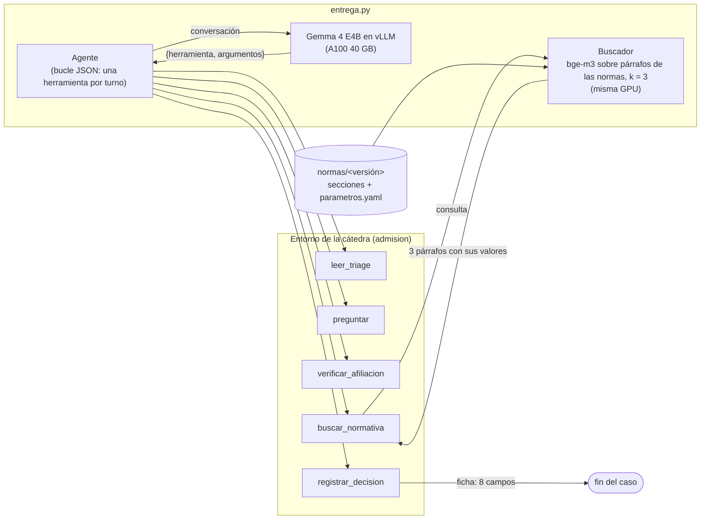

# Agente de admisión de guardia

Trabajo final — Inteligencia Artificial Generativa — Universidad Austral — **Grupo 11**

| | |
|---|---|
| Modelo en Hugging Face | [Pedro2204/admision-gemma4-e4b](https://huggingface.co/Pedro2204/admision-gemma4-e4b) (privado) — revisión del punto de control final: `671cca684d39f1e78a5856ae6414e3fff20e8a06` (etiqueta `sft-mixto-final`) |
| Datos de entrenamiento | [Pedro2204/admision-gemma4-e4b-datos](https://huggingface.co/datasets/Pedro2204/admision-gemma4-e4b-datos) (privado) |
| Proyecto de W&B | [pdelaguila-universidad-austral/admision-guardia](https://forge.coreweave.com/wandb/pdelaguila-universidad-austral/admision-guardia) |
| Presentación en Loom | pendiente |

**Resultado del modelo final** sobre los 50 casos de práctica: **49, 50 y 50** con las normas
original, b y c (referencia de la cátedra con SFT: 25, 24, 25), a 0,44 s y USD 0,00026 por caso en
una A100 de 40 GB. Detalle en `INFORME.md`.

Integrantes:

- Celina Arias Duval — cariasduval@mail.austral.edu.ar — `cmariasduval`
- Elias Ballesteros — eballesteros@mail.austral.edu.ar — `Elias85974`
- Pedro Del Aguila — pdelaguila@mail.austral.edu.ar — `pedrodelaguila`
- Trinidad Martinez — tmartinez1@mail.austral.edu.ar — `TMartinez0744`

Todo lo de abajo se sigue **con el punto de control publicado, sin necesidad de volver a entrenar**.

## 1. Entorno

El kit de la cátedra va **al lado del repo**: `pyproject.toml` lo toma como dependencia desde
`../talksmith-ing/missions/TPFinal` (no se copia `admision/` adentro del repo).

```bash
git clone https://github.com/austral-ing-ai/talksmith-ing.git ../talksmith-ing
uv sync
cp .env.example .env   # completar con los valores reales
```

Variables (`.env.example`):

- `HF_TOKEN`: hace falta para bajar el punto de control final, que está en un repositorio privado de
  Hugging Face; el token tiene que ser de una cuenta con acceso a ese repositorio.
- `WANDB_API_KEY`: solo para volver a entrenar.

`entrega.py` necesita una GPU con CUDA: vLLM se instala solo en Linux (`pyproject.toml`). Sin GPU
propia, todos los comandos corren en una A100 de 40 GB de Modal con `modal_app.py`, después de
`uv run modal token new`.

## 2. Un caso

El primer caso de práctica (`pev-001`) con las normas b:

```bash
K=../talksmith-ing/missions/TPFinal
mkdir -p /tmp/un-caso && head -n 1 $K/practica/casos.jsonl > /tmp/un-caso/casos.jsonl
uv run python -m admision.correr practica --entrega entrega.py --casos /tmp/un-caso/casos.jsonl \
    --esperadas $K/practica/esperadas-b.jsonl --normas $K/normas/b --salida corridas/un-caso
```

En una A100 de Modal (las salidas quedan en el volumen y se bajan después):

```bash
K=../talksmith-ing/missions/TPFinal
uv run modal run modal_app.py --comando "mkdir -p /tmp/un-caso && head -n 1 $K/practica/casos.jsonl \
    > /tmp/un-caso/casos.jsonl && python -m admision.correr practica --entrega entrega.py \
    --casos /tmp/un-caso/casos.jsonl --esperadas $K/practica/esperadas-b.jsonl --normas $K/normas/b \
    --salida /cache/corridas/un-caso"
uv run modal volume get admision-cache corridas/un-caso corridas/
```

Qué se ve, en la carpeta de `--salida`:

- `trazas.jsonl`, una línea por caso: `mensajes` es la conversación completa con el modelo (el
  mensaje de sistema, cada llamada en JSON y cada resultado), y `log` es cada llamada a una
  herramienta con su resultado. Ahí están las búsquedas en las normas
  (`buscar_normativa` → los 3 párrafos que trajo el buscador) y la ficha registrada
  (`registrar_decision`).
- `resultados.jsonl`, una línea por caso: los 9 controles (`controles`), si quedó resuelto, la ficha
  esperada y la obtenida.
- `resumen.json`: casos resueltos, acierto por control, búsquedas, contexto y tiempos.

Lo que dio esa corrida (`evaluacion/corridas/un-caso/`), con el modelo final:

1. `leer_triage(P-2537)` → Teresa Figueroa, 53 años, nivel 3, dolor torácico, llegó por sus
   propios medios, presentó la credencial de Prepaga Sierra n.º 498055/03.
2. `buscar_normativa("registro del paciente y ubicación en el box")` → NOR-ADM-02 y NOR-ADM-01, con
   `Valores: P-ADM-2 = 60 años` y `P-ADM-1 = nivel 1`.
3. `buscar_normativa("dolor torácico plazo")` → NOR-TDE-01 (`P-TDE-1 = 15 min`) y NOR-TDE-04
   (`P-TDE-5 = 3 min`, ambulancia).
4. `buscar_normativa("número de afiliado con terminación reservada")` → NOR-COB-04
   (`P-COB-2 = 3`).
5. `verificar_afiliacion(Prepaga Sierra, 498055/03)` → activa.
6. `registrar_decision`: registro provisorio, sin documento, sin box previo, circuito `ecg` a
   **15 min**, cobertura **`sin_cobertura`** y entidad a notificar **Prepaga Sierra**.

**Los 9 controles bien.** El número de afiliado termina en 3, el dígito reservado de las normas b,
así que corresponde sin cobertura pero notificando a la prepaga (NOR-COB-04); con las normas
originales el dígito es 7 y la misma paciente queda con cobertura de prepaga. El plazo, 15 min, es el
de las normas b (en las originales, 10). El modelo lee los dos valores del buscador. El caso tardó
5,4 s; cargar el agente, 276 s (una vez por proceso).

## 3. El buscador

```bash
uv run python -m admision.evaluar_rag --entrega entrega.py \
    --normas <kit>/normas/original --consultas <kit>/rag/consultas_dev.jsonl
```

## 4. La evaluación completa

Los 50 casos de práctica con las normas original, b y c, que producen la tabla del informe:

```bash
K=../talksmith-ing/missions/TPFinal
for v in original b c; do
  uv run modal run modal_app.py --comando "python -m admision.correr practica --entrega entrega.py \
      --casos $K/practica/casos.jsonl --esperadas $K/practica/esperadas-$v.jsonl \
      --normas $K/normas/$v --salida /cache/corridas/<nombre>-$v"
  uv run modal volume get admision-cache corridas/<nombre>-$v evaluacion/corridas/
done
uv run python -m evaluacion.tabla evaluacion/corridas/<nombre>
```

`evaluacion.tabla` lee los tres `resumen.json` y escribe la fila de la tabla: casos resueltos por
versión, búsquedas, contexto y segundos por caso. Las corridas de cada número del informe están en
`evaluacion/corridas/`, con todas sus conversaciones.

## 5. De dónde sale cada archivo

Qué código, qué punto de control y qué prompt usó cada corrida de evaluación: `evaluacion/corridas/README.md`.

| Archivo | Lo genera | Configuración y semilla |
|---|---|---|
| `historial_clasificado.csv` | `uv run python -m curado.clasificar` | sin aleatoriedad |
| `datos/conversaciones.jsonl` | `uv run python -m curado.conversaciones` | sin aleatoriedad |
| `prompt/sistema_optimizado.txt` | `uv run python -m prompt.optimizar --kit <kit> --salida corridas/gepa` | semilla 0, 60 + 40 casos generados, 600 casos jugados |
| `datos/entrenamiento-reales.jsonl` | `uv run python -m entrenamiento.datos --kit <kit> --sistema prompt/sistema_optimizado.txt --salida datos/entrenamiento-reales.jsonl` | semilla 0, 1600 reales |
| `datos/entrenamiento-mixto.jsonl` | `uv run python -m entrenamiento.datos --kit <kit> --sistema prompt/sistema_optimizado.txt --sinteticas 1600 --salida datos/entrenamiento-mixto.jsonl` | semilla 0, 1600 reales + 1600 sintéticas |
| `prompt/sistema_final.txt`, `prompt/sistema_inicial.txt`, `prompt/sistema_catedra.txt` | `uv run python -m prompt.archivos` (el final es `sistema_optimizado.txt` con la regla de `aviso_al_voluntariado` reemplazada por la costumbre; ver INFORME, Parte 4) | sin aleatoriedad |
| `datos/entrenamiento-mixto-catedra.jsonl` | `uv run python -m entrenamiento.datos --kit <kit> --sistema prompt/sistema_catedra.txt --sinteticas 1600 --salida datos/entrenamiento-mixto-catedra.jsonl` | semilla 0, 1600 reales + 1600 sintéticas |
| `datos/entrenamiento-mixto-final.jsonl` (el del modelo final) | `uv run python -m entrenamiento.datos --kit <kit> --sistema prompt/sistema_final.txt --sinteticas 1600 --salida datos/entrenamiento-mixto-final.jsonl` | semilla 0, 1600 reales + 1600 sintéticas |
| `evaluacion/corridas/<corrida>-<versión>/` | `admision.correr practica` (sección 4); la fila del informe, `uv run python -m evaluacion.tabla` | greedy (temperatura 0) |
| `evaluacion/corridas/capacidad-*/` | `uv run python -m evaluacion.capacidad --kit <kit> --salida ...` | casos generados con semilla 1 |
| `evaluacion/entrenamientos/<corrida>/resumen.json` | lo escribe `entrenamiento/sft.py` al terminar | semilla 0 |
| cada entrenamiento | `entrenamiento/sft.py` (ver abajo) | configuración, semilla y revisiones en W&B y en `evaluacion/entrenamientos/<corrida>/resumen.json` |

Volver a entrenar (no hace falta para verificar nada de lo de arriba: los puntos de control están
publicados). Necesita `HF_TOKEN` y `WANDB_API_KEY` en `.env`; los datos se suben antes al volumen de
Modal:

```bash
uv run modal volume put admision-cache datos/entrenamiento-mixto-final.jsonl /datos/entrenamiento-mixto-final.jsonl
uv run modal run modal_app.py --comando "python -m entrenamiento.sft --datos /cache/datos/entrenamiento-mixto-final.jsonl \
    --nombre sft-mixto-final --hub <usuario>/admision-gemma4-e4b --salida /cache/modelos/sft-mixto-final --epocas 1"
```

La semilla (0) y el resto de la configuración son los valores por defecto de `entrenamiento/sft.py`;
cada corrida deja en W&B y en `resumen.json` la configuración completa, el sha256 y la revisión de
Hugging Face de los datos, y la revisión del modelo fusionado.

## 6. Diagrama



1. El agente le pasa la conversación al modelo, que responde una llamada a herramienta en JSON.
2. El agente la ejecuta en el entorno y agrega el resultado a la conversación como mensaje del usuario.
3. `buscar_normativa` llama al buscador del grupo, armado con la carpeta de normas que se recibe:
   los números cambian entre versiones y nunca están en los pesos ni en el prompt.
4. El caso termina con `registrar_decision`, o al llegar a 40 llamadas.
