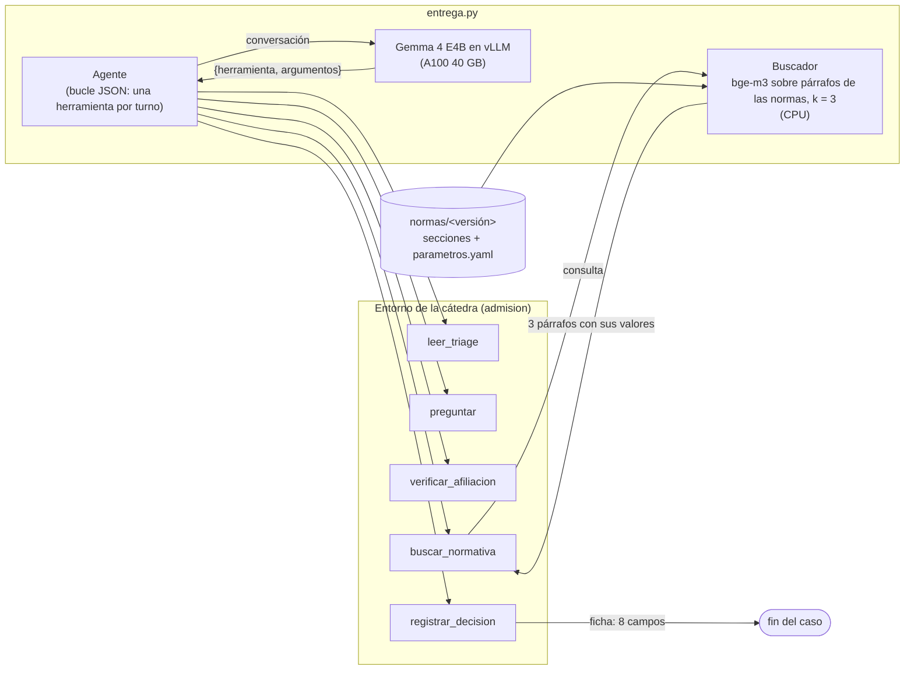

# Agente de admisión de guardia

Trabajo final — Inteligencia Artificial Generativa — Universidad Austral — **Grupo 11**

| | |
|---|---|
| Modelo en Hugging Face | [Pedro2204/admision-gemma4-e4b](https://huggingface.co/Pedro2204/admision-gemma4-e4b) (privado) — revisión del punto de control final: `671cca684d39f1e78a5856ae6414e3fff20e8a06` (etiqueta `sft-mixto-final`) |
| Datos de entrenamiento | [Pedro2204/admision-gemma4-e4b-datos](https://huggingface.co/datasets/Pedro2204/admision-gemma4-e4b-datos) (privado) |
| Proyecto de W&B | [pdelaguila-universidad-austral/admision-guardia](https://forge.coreweave.com/wandb/pdelaguila-universidad-austral/admision-guardia) |
| Presentación en Loom | pendiente |

**Resultado del modelo final** sobre los 50 casos de práctica: **49, 50 y 50** con las normas
original, b y c (referencia de la cátedra con SFT: 25, 24, 25), a 0,44 s y USD 0,00026 por caso en
una A100 de 40 GB. Detalle en `INFORME.md`.

Integrantes:

- Celina Arias Duval — cariasduval@mail.austral.edu.ar — `cmariasduval`
- Elias Ballesteros — eballesteros@mail.austral.edu.ar — `Elias85974`
- Pedro Del Aguila — pdelaguila@mail.austral.edu.ar — `pedrodelaguila`
- Trinidad Martinez — tmartinez1@mail.austral.edu.ar — `TMartinez0744`

Todo lo de abajo se sigue **con el punto de control publicado y sin entrenar**.

## 1. Entorno

```bash
uv sync
cp .env.example .env   # completar con los valores reales
```

El kit se agrega como dependencia, con la ruta a su carpeta:

```bash
uv add <ruta>/talksmith-ing/missions/TPFinal
```

Variables necesarias: ver `.env.example`.

## 2. Un caso

```bash
uv run python -m admision.correr practica --entrega entrega.py \
    --casos <kit>/practica/casos.jsonl \
    --esperadas <kit>/practica/esperadas-original.jsonl \
    --normas <kit>/normas/original --salida corridas/original
```

Hace falta una GPU con vLLM (Linux). Sin GPU propia, el mismo comando corre en una A100 de 40 GB
de Modal; las salidas quedan en el volumen y se bajan después:

```bash
uv run modal run modal_app.py --comando "python -m admision.correr practica --entrega entrega.py \
    --casos ../talksmith-ing/missions/TPFinal/practica/casos.jsonl \
    --esperadas ../talksmith-ing/missions/TPFinal/practica/esperadas-original.jsonl \
    --normas ../talksmith-ing/missions/TPFinal/normas/original --salida /cache/corridas/original"
uv run modal volume get admision-cache corridas/original corridas/
```

Qué se ve, en la carpeta de `--salida`:

- `trazas.jsonl`, una línea por caso: `mensajes` es la conversación completa con el modelo (el
  mensaje de sistema, cada llamada en JSON y cada resultado), y `log` es cada llamada a una
  herramienta con su resultado. Ahí están las búsquedas en las normas
  (`buscar_normativa` → los 3 párrafos que trajo el buscador) y la ficha registrada
  (`registrar_decision`).
- `resultados.jsonl`, una línea por caso: los 9 controles (`controles`), si quedó resuelto, la ficha
  esperada y la obtenida.
- `resumen.json`: casos resueltos, acierto por control, búsquedas, contexto y tiempos.

Por ejemplo, el caso `pev-001` de la línea base (`evaluacion/corridas/base-original/`):
`leer_triage` → `verificar_afiliacion` (Prepaga Sierra, activa) → `buscar_normativa("dolor torácico
y prepaga")`, que trae NOR-TDE-01 → `registrar_decision` con circuito `ecg`, y los 9 controles bien.

## 3. El buscador

```bash
uv run python -m admision.evaluar_rag --entrega entrega.py \
    --normas <kit>/normas/original --consultas <kit>/rag/consultas_dev.jsonl
```

## 4. La evaluación completa

Los 50 casos de práctica con las normas original, b y c, que producen la tabla del informe:

```bash
K=../talksmith-ing/missions/TPFinal
for v in original b c; do
  uv run modal run modal_app.py --comando "python -m admision.correr practica --entrega entrega.py \
      --casos $K/practica/casos.jsonl --esperadas $K/practica/esperadas-$v.jsonl \
      --normas $K/normas/$v --salida /cache/corridas/<nombre>-$v"
  uv run modal volume get admision-cache corridas/<nombre>-$v evaluacion/corridas/
done
uv run python -m evaluacion.tabla evaluacion/corridas/<nombre>
```

`evaluacion.tabla` lee los tres `resumen.json` y escribe la fila de la tabla: casos resueltos por
versión, búsquedas, contexto y segundos por caso. Las corridas de cada número del informe están en
`evaluacion/corridas/`, con todas sus conversaciones.

## 5. De dónde sale cada archivo

Qué código, qué punto de control y qué prompt usó cada corrida de evaluación: `evaluacion/corridas/README.md`.

| Archivo | Lo genera | Configuración y semilla |
|---|---|---|
| `historial_clasificado.csv` | `uv run python -m curado.clasificar` | sin aleatoriedad |
| `datos/conversaciones.jsonl` | `uv run python -m curado.conversaciones` | sin aleatoriedad |
| `prompt/sistema_optimizado.txt` | `uv run python -m prompt.optimizar --kit <kit> --salida corridas/gepa` | semilla 0, 60 + 40 casos generados, 600 casos jugados |
| `datos/entrenamiento-reales.jsonl` | `uv run python -m entrenamiento.datos --kit <kit> --sistema prompt/sistema_optimizado.txt --salida datos/entrenamiento-reales.jsonl` | semilla 0, 1600 reales |
| `datos/entrenamiento-mixto.jsonl` | `uv run python -m entrenamiento.datos --kit <kit> --sistema prompt/sistema_optimizado.txt --sinteticas 1600 --salida datos/entrenamiento-mixto.jsonl` | semilla 0, 1600 reales + 1600 sintéticas |
| `prompt/sistema_final.txt`, `prompt/sistema_inicial.txt`, `prompt/sistema_catedra.txt` | `uv run python -m prompt.archivos` (el final es `sistema_optimizado.txt` con la regla de `aviso_al_voluntariado` reemplazada por la costumbre; ver INFORME, Parte 4) | sin aleatoriedad |
| `datos/entrenamiento-mixto-final.jsonl` (el del modelo final) | `uv run python -m entrenamiento.datos --kit <kit> --sistema prompt/sistema_final.txt --sinteticas 1600 --salida datos/entrenamiento-mixto-final.jsonl` | semilla 0, 1600 reales + 1600 sintéticas |
| `evaluacion/corridas/<corrida>-<versión>/` | `admision.correr practica` (sección 4); la fila del informe, `uv run python -m evaluacion.tabla` | greedy (temperatura 0) |
| `evaluacion/corridas/capacidad-*/` | `uv run python -m evaluacion.capacidad --kit <kit> --salida ...` | casos generados con semilla 1 |
| `evaluacion/entrenamientos/<corrida>/resumen.json` | lo escribe `entrenamiento/sft.py` al terminar | semilla 0 |
| `datos/entrenamiento-mixto-catedra.jsonl` | `uv run python -m entrenamiento.datos --kit <kit> --sistema prompt/sistema_catedra.txt --sinteticas 1600 --salida datos/entrenamiento-mixto-catedra.jsonl` | semilla 0, 1600 reales + 1600 sintéticas |
| cada entrenamiento | `entrenamiento/sft.py` (ver abajo) | configuración, semilla y revisiones en W&B y en `evaluacion/entrenamientos/<corrida>/resumen.json` |

Volver a entrenar (no hace falta para verificar nada de lo de arriba: los puntos de control están
publicados). Necesita `HF_TOKEN` y `WANDB_API_KEY` en `.env`; los datos se suben antes al volumen de
Modal:

```bash
uv run modal volume put admision-cache datos/entrenamiento-mixto-final.jsonl /datos/entrenamiento-mixto-final.jsonl
uv run modal run modal_app.py --comando "python -m entrenamiento.sft --datos /cache/datos/entrenamiento-mixto-final.jsonl \
    --nombre sft-mixto-final --hub <usuario>/admision-gemma4-e4b --salida /cache/modelos/sft-mixto-final --epocas 1"
```

La semilla (0) y el resto de la configuración son los valores por defecto de `entrenamiento/sft.py`;
cada corrida deja en W&B y en `resumen.json` la configuración completa, el sha256 y la revisión de
Hugging Face de los datos, y la revisión del modelo fusionado.

## 6. Diagrama



1. El agente le pasa la conversación al modelo, que responde una llamada a herramienta en JSON.
2. El agente la ejecuta en el entorno y agrega el resultado a la conversación como mensaje del usuario.
3. `buscar_normativa` llama al buscador del grupo, armado con la carpeta de normas que se recibe:
   los números cambian entre versiones y nunca están en los pesos ni en el prompt.
4. El caso termina con `registrar_decision`, o al llegar a 40 llamadas.
